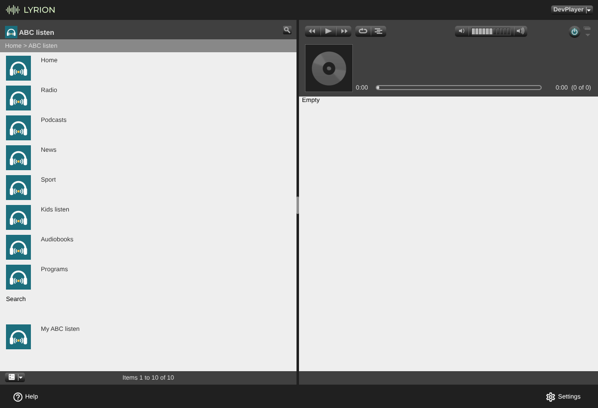
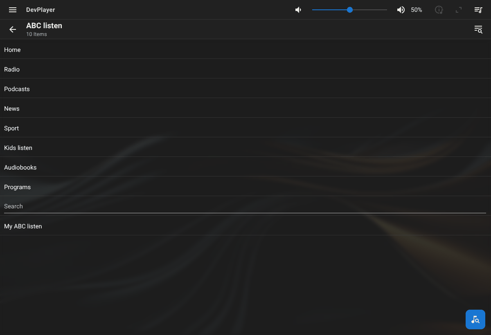
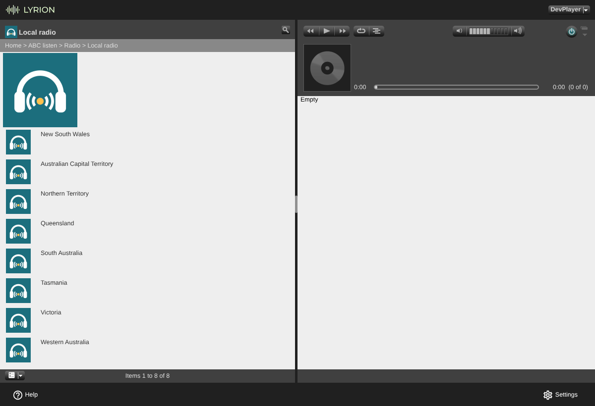
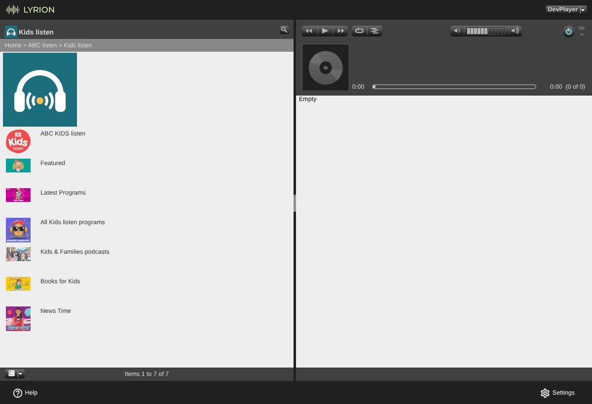
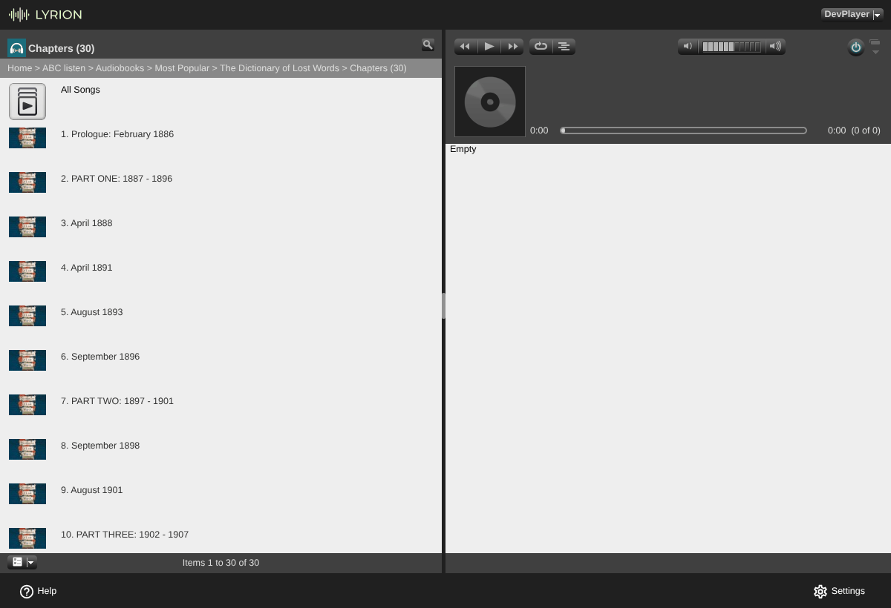
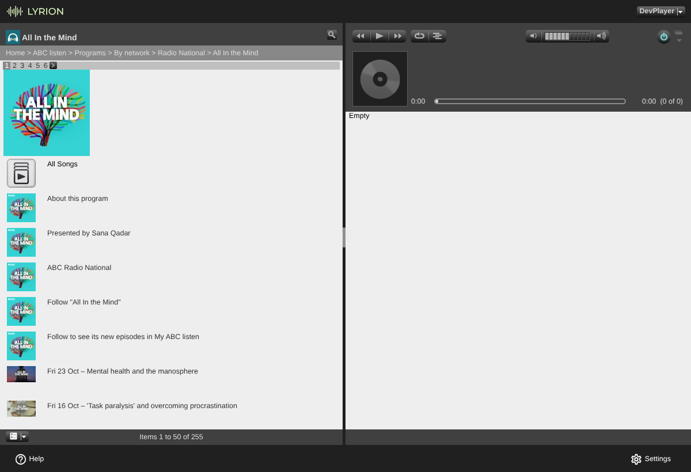
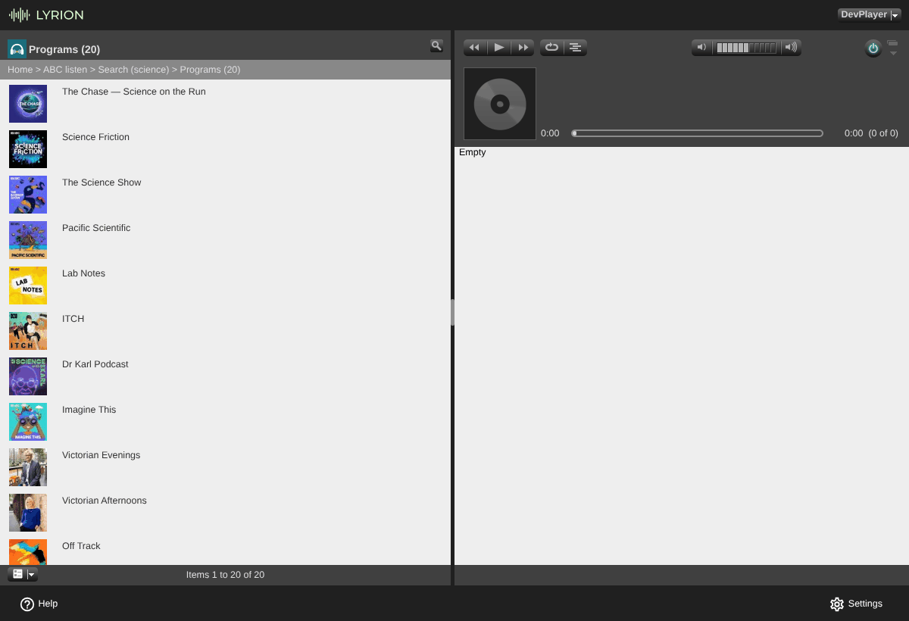
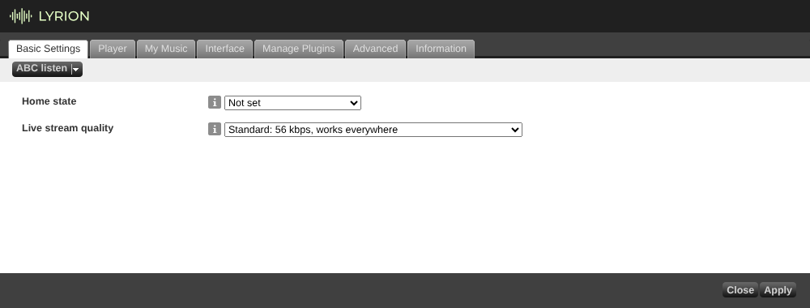
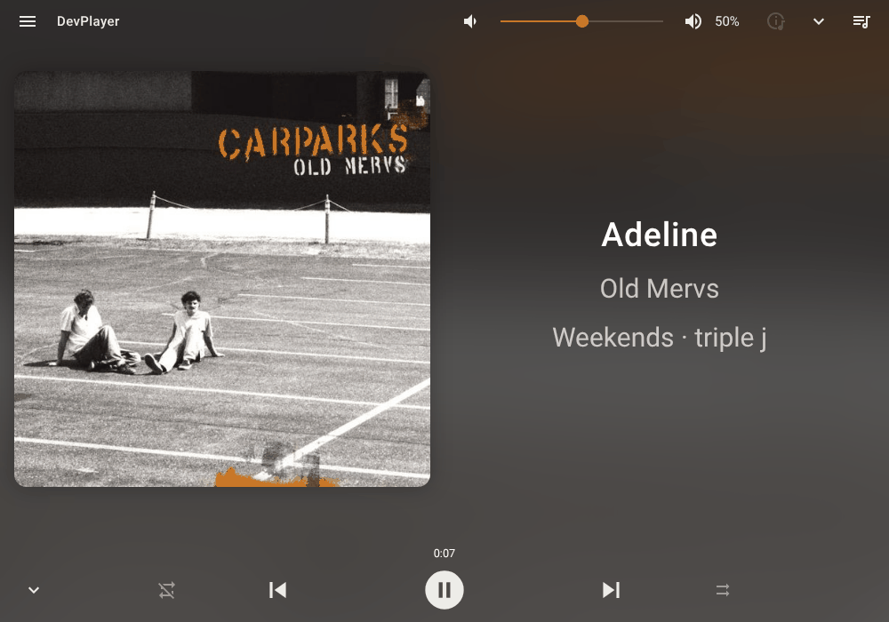

# SqueezeABCListen

An unofficial [Lyrion Music Server](https://lyrion.org/) (LMS, formerly Logitech Media Server /
Squeezebox Server) plugin for **ABC listen**, the radio and podcast service of the Australian
Broadcasting Corporation.

## About

The plugin adds **ABC listen** to the LMS Radio menu, laid out like ABC's own ABC listen app:
every ABC live radio station with what's on air, ABC's podcasts and radio programs with their
episodes, the News, Sport, Kids listen and Audiobooks sections, search, and a list of programs you
follow. It works like any other LMS radio source and has been tested with squeezelite players,
the LMS web interfaces and the Squeezer app. Squeezebox hardware players use the same standard
LMS menus but haven't been tested yet (see [Compatibility](#compatibility)). No ABC account
is needed.

This guide describes the latest release. See [CHANGELOG.md](CHANGELOG.md) for what each version
contains, and [Updating](#updating) for how to check which version you have.

## Features

- **Live radio:** every ABC listen station: the national networks (Radio National, NewsRadio,
  triple j, Double J, ABC Classic, ABC Jazz, ABC Country and more), local radio grouped by state
  with your home state first, sport stations, and the time-zone versions of the networks. Each
  station has its logo.
- **What's on air:** the program and presenters on air, in the Radio menus and in Now Playing. On
  music stations Now Playing shows the song, the artist and the cover, with a list of the songs
  played recently.
- **Station schedules:** today's, yesterday's and the five days before, in the station's own time
  zone. A program that has already aired opens its catch-up episodes.
- **Podcasts:** ABC's podcast collections, all 18 podcast categories and an A–Z list of every
  podcast.
- **News, Sport, Kids listen and Audiobooks**, as in the app: their live stations, programs and
  collections. Sport lists live and upcoming events with their times.
- **Programs:** by network, A–Z or by type. A program shows its description and episodes, newest
  first. An episode shows its presenters, its segments, its tracklist and a link to more from its
  program.
- **Episodes** play and seek, with title, program, artwork and duration in Now Playing.
- **Audiobooks:** each book lists its chapters in reading order, and plays or queues the whole
  book.
- **Search** for programs and episodes, also from LMS's own search.
- **My ABC listen:** follow programs and see their latest episodes in one list. Follows are stored
  in LMS; no ABC login.
- **Settings:** your home state, and the live stream quality: the standard streams, ABC's HLS
  streams (192 kbps AAC on the music stations) or ABC's mediahub streams.
- Standard LMS menus, so the Default and Material web interfaces, Squeezebox players and LMS
  apps all show the same items (see [Compatibility](#compatibility)).

## Disclaimer

This is an **unofficial** plugin. It is **not affiliated with or endorsed by the Australian
Broadcasting Corporation (ABC)**. The ABC, ABC listen and station names and logos belong to the
ABC; they are used here only to identify the stations and programs. The plugin plays ABC's own
streams and files straight from ABC's servers; it never copies or re-hosts any audio. For the
ABC's own apps and website, visit <https://www.abc.net.au/listen>.

## Requirements

- Lyrion Music Server (or Logitech Media Server) **8.3 or later**. Tested on LMS 9.1.1; see
  [Compatibility](#compatibility).
- Internet access from the LMS server to the ABC's servers.
- AAC decoding: the live streams are AAC (HE-AAC at the standard quality). Software players such
  as squeezelite and most apps play them directly; older hardware players need the server to
  transcode AAC (LMS's `faad` helper; see [Troubleshooting](#troubleshooting)).

## Installation

1. In the LMS web interface, open **Settings → Manage Plugins** and scroll down to
   **Additional Repositories**.
2. Paste this URL into the empty field and click **Apply**:

   ```
   https://raw.githubusercontent.com/wilsonwaters/SqueezeABCListen/main/repo.xml
   ```

3. A new section, **SqueezeABCListen plugin repository**, appears in the plugin list. Tick
   **ABC listen** and click **Apply**.
4. LMS asks you to confirm installing a plugin from a third-party repository ("You are about to
   install: … Only install extensions from authors whom you trust. …"). Click **OK**.
5. LMS downloads the plugin (from raw.githubusercontent.com, like the repository file), checks
   it, and asks to restart. Click **Restart now**, or restart LMS the way you normally do.
6. Open **Radio → ABC listen** on any player or in the web interface.

## Usage

Everything is under **Radio → ABC listen**: in the Default web interface
**Home → Radio → ABC listen**, in Material and on players **Radio → ABC listen**. The top level
has ten entries, in the same order as the ABC listen app:

| Entry | What it has |
|---|---|
| **Home** | ABC listen's featured items, what's popular and ABC's home-page collections |
| **Radio** | Every live station: networks, sport, local radio and time-zone versions |
| **Podcasts** | ABC's podcast collections, categories and an A–Z list |
| **News** | NewsRadio and ABC's news programs |
| **Sport** | The sport stations, live and upcoming events, and sport programs |
| **Kids listen** | The ABC KIDS listen station, kids' programs, podcasts and books |
| **Audiobooks** | ABC's audiobooks, by collection and A–Z |
| **Programs** | ABC's radio programs and podcasts, by network, A–Z or by type |
| **Search** | Search ABC listen for programs and episodes |
| **My ABC listen** | The programs you follow and their latest episodes |





Items with a play button play straight away. Click an item's name (or open it on a player) to see
what's inside. In menus that show a second line (Material, players and apps), stations show
what's on air and episodes show their date and duration.

### Home

**Home** starts with **Featured**, **Popular now** and **Popular in sport**, then ABC listen's
own home-page collections, such as "Today's Top Picks" and "Most Popular Podcasts". Each lists
programs and episodes; an episode plays from its row, and a program opens its episode list.

### Radio

**Radio** lists the national networks first (Radio National, NewsRadio, ABC KIDS listen, Radio
Australia, ABC Classic, triple j, Double J, ABC Country, ABC Jazz, triple j Unearthed, Classic 2
and triple j Hottest), then:

- **Sport**: ABC SPORT, ABC SPORT EXTRA and the event stations while an event is on.
- **Local radio**: one entry per state and territory. Your home state comes first, named
  "*state* (your state)", for example "Queensland (your state)" (see [Settings](#settings)). Each
  state lists its ABC local stations, such as 702 ABC Sydney or ABC Wide Bay.
- **Time-zone versions**: the networks as they are broadcast in other time zones, such as
  "Radio National WA" or "ABC Classic Adelaide".

A station's play button plays it live. Open the station for its menu:

1. **Listen live**.
2. "On air: *program* · *presenters*", the program on air now.
3. **Today**, **Yesterday** and the five days before: that day's schedule in the station's own
   time zone ("Fri 23 Oct · Sydney time"), one row per program with its start time
   ("1:00am · Health Report"). The program on air is marked **(on air)**. Open a program that has
   already aired to play its catch-up episodes.



### Podcasts

**Podcasts** has ABC's podcast collections ("New & Noteworthy", "Most Popular Podcasts" and
"Award Winning Podcasts"), then **Browse by category** with all 18 of ABC's podcast categories,
and **All podcasts A–Z**, grouped by first letter.

### News

**News** starts with the NewsRadio live stream, then ABC's news collections, such as "Latest
News", "ABC News Daily" and "Latest Current Affairs". News bulletins and current affairs programs
play from their rows.

### Sport

**Sport** lists the sport stations, then ABC's "Live & Upcoming Events" (the events that are live
or coming up, each with its time, when there are any), and then ABC's sport collections and sport
programs.

### Kids listen

**Kids listen** follows ABC's Kids listen app section:

- the ABC KIDS listen live station;
- **Featured** and ABC's "Latest Programs" collection;
- **All Kids listen programs**, A–Z;
- **Kids & Families podcasts**, such as Bluey Listen Along (its episodes are listed under
  **Episodes (N)**);
- **Books for Kids**: audiobooks for children, each with its **Chapters**;
- News Time, ABC's news program for kids.



### Audiobooks

**Audiobooks** has ABC's audiobook collections ("Most Popular", "Top 100 Australian Books", "Crime
& Thriller" and more), **All audiobooks A–Z**, and the note
"**Most audiobooks play only in Australia.**" (see [Limitations](#limitations)).

Open a book for its description, its reader ("Presented by …") and **Chapters (N)**. **Chapters**
lists the book in reading order, numbered: "1. Prologue: February 1886", "2. PART ONE: 1887 -
1896", and so on. A chapter plays from its row. To play the whole book, play **Chapters** itself:
its play button (or **All Songs** in the Default web interface, the play and add buttons in
Material) queues every chapter in order.



### Programs

**Programs** has three ways in:

- **By network**: Radio National, triple j, Double J, ABC Classic and the other networks, each
  with its programs, A–Z.
- **All programs A–Z**: every program and podcast in ABC's index (more than 700), grouped by
  first letter ("A (98)"). Programs that share a title, such as the regional "Mornings" programs,
  are each listed, named "*title* (*network*)".
- **By type**: **Podcasts**, **Catch-up radio**, **Music**, **News briefings**, **Audiobooks** and
  **Other**.

A program's page shows its description, "Presented by …", its network, the follow rows (see
[My ABC listen](#my-abc-listen)) and then its episodes, newest first, named with their broadcast
date and title ("Fri 23 Oct – Mental health and the manosphere"), as one list back to the oldest
episode ABC lists (its newest 250). Programs use ABC's current titles, such as "Radio National
Breakfast" and "If You're Listening".



The description at the top of a program's page is kept short: its first paragraph, up to about
200 characters. When that isn't the whole text, **About this program**, right below it, opens all
of it. Apps such as Squeezer show the description as a fixed header above the list, so a short
one leaves room for the episodes. A program with more than 200 rows (most daily programs) shows no
description at the top and starts with **About this program** instead.

An episode plays from its row. Open it for:

- its synopsis, kept short in the same way, and **About this episode** for the whole text when
  it is longer;
- **Play episode**;
- "Broadcast *date* · *duration*";
- "Presented by …", the episode's presenters;
- **Segments (N)** for programs in parts, such as The Science Show and Radio National
  Breakfast: each segment plays on its own, named "1 of 5 – …";
- **Tracklist (N)** for music programs, one row per piece with its time into the program
  ("00:55 · Rossini, Gioachino – The Barber of Seville: Overture"). Talk programs say
  **No tracklist**, and **Tracklist unavailable** means ABC didn't answer in time;
- **More from *program***, which opens the episode's program.

Episodes can be sought: drag the progress bar in the web interface, or use your player's or app's
seek controls.

### Search

**Search** asks for a word or phrase and answers with **Programs (N)** and **Episodes (N)**. Open
either to see the results; programs open their episode list and episodes play from their row.
Programs that share a title are each listed, named "*title* (*network*)", as in All programs A–Z.

ABC listen also answers LMS's own search, the global search that Squeezebox Touch, Radio and
Controller players and some LMS apps offer in their Search menu: it lists an **ABC listen** entry
with **Results for '*your words*'** and the same **Programs (N)** and **Episodes (N)** lists.
Material's own search box doesn't include ABC listen; use **ABC listen → Search** there.



### My ABC listen

Every program menu has a follow row: **Follow "*program*"**, followed by the hint "Follow to see
its new episodes in My ABC listen". Choose it, and the row becomes "**✓ Following "*program*"**"
with **Unfollow "*program*"** under it. Programs can also be followed from **Song Info** while one
of their episodes plays.

**My ABC listen** then has:

- **Latest episodes**: the newest episodes of every program you follow, newest first, up to 50;
- **Followed programs (N)**: the programs you follow, in the order you followed them.

Until you follow something it says "**Open any program and choose Follow**". Follows are kept in
LMS itself, for the whole server: every player sees the same list.

### Settings

Open **Settings → Advanced → ABC listen**
(or **Settings → Manage Plugins → ABC listen → Settings**):

- **Home state**: your state or territory (or **Not set**). Its local stations come first in
  **Local radio**, and the networks play your state's time-zone version where ABC has one (for
  example, "Radio National WA" for Western Australia). Not set behaves like New South Wales.
- **Live stream quality**:
  - **Standard: 56 kbps, works everywhere** (the default): ABC's Icecast HE-AAC streams.
  - **High quality (HLS)**: ABC's HLS streams, the ones ABC's website plays: 192 kbps AAC on the
    music stations and 64 kbps on talk stations. The plugin plays them itself; there is nothing
    else to install.
    - If a station's HLS stream can't be played (some play only in Australia), the same play
      falls back to the standard stream by itself, within about 12 seconds.
    - It also lists the stations ABC streams only in HLS: the Sport Rapid, RLWC Rapid and ABC
      Cricket streams under Sport, and the Northern Territory, Queensland, South Australia and
      Western Australia versions of ABC KIDS listen under Kids listen. They have no standard
      stream to fall back to.
    - It costs more CPU on the LMS server: LMS itself fetches the audio and passes it on to the
      player, while a standard stream goes straight to the player. That was about 4–6% of one
      core on an x86 test server; it hasn't been measured on a Raspberry Pi yet.
    - The stream runs about 30–40 seconds behind live, as on ABC's website, so Now Playing shows
      a new song or program about 30–40 seconds before you hear it.
  - **ABC mediahub AAC: higher quality, may only work in Australia**: ABC's own higher-quality
    streams. If one can't be played, the plugin falls back to the standard stream by itself,
    after a short delay.



### Favourites

Stations and episodes can be saved as LMS favourites: use the favourite (heart) button or
**Save to Favorites** in the web interface, or your player's or app's "add to favourites" action. A
station favourite always plays the station live, even if ABC changes its stream addresses. An
episode favourite plays until ABC removes the episode. Programs aren't favourites: follow them
instead (see [My ABC listen](#my-abc-listen)).

## Now playing

**Talk stations** (Radio National, NewsRadio, local radio and others) show the program on air:
its name as the title, the presenters, and the program's image. **Song Info** (Material:
**More**) has **Program info**: the program's description, its time slot and what's on next. Now
Playing changes by itself about 30 seconds after each program change.

**Music stations** (triple j, Double J, triple j Unearthed, ABC Jazz, ABC Country, ABC Classic,
Classic 2, triple j Hottest and ABC KIDS listen) show the song playing: its title, the artist and
the cover art, updated at every song change (the plugin checks ABC's song data every 20 seconds to
2 minutes, and at the end of each song). Between songs, Now Playing shows the program.
**Song Info** also has **Recently played**, the last ten songs with their times.



**Episodes** show the episode's title, the program, the episode's artwork and its duration, and
can be sought. **Song Info** for an episode has **Episode notes**, **More from** *program*, its
tracklist, and the program's follow row.

## Limitations

These come from what ABC publishes, or from LMS:

- **Live streams are 56 kbps HE-AAC by default.** Choose **High quality (HLS)** (see
  [Settings](#settings)) for 192 kbps AAC on the music stations; it costs more CPU on the LMS
  server. **ABC mediahub AAC** may only work from an Australian internet connection; elsewhere
  each play falls back to the standard stream after a short delay.
- **Stations that ABC streams only as HLS are listed only with High quality (HLS)**: the Sport
  Rapid, RLWC Rapid and ABC Cricket streams and the Kids listen time-zone versions. They have no
  standard stream, so they can't fall back to one; ABC Cricket, and possibly the Rapid streams,
  may play only in Australia, and ABC Cricket only during matches. Event stations appear only
  while their event is on.
- **With High quality (HLS), Now Playing is ahead of the audio.** HLS plays about 30–40 seconds
  behind live, while song titles and programs come from ABC's live data, so they change about
  30–40 seconds before you hear the change.
- **Only the newest 250 episodes** of each program are listed, because that is all ABC lists.
- **ABC's program index still lists some programs that have stopped**, such as several regional
  "Mornings" programs and some weekend shows. Their newest episodes can be years old and may say
  they are no longer available. A few programs that ABC doesn't index at all (Comedy Showcase,
  Grass Roots, Desko) are only under **Programs → By network**.
- **Catch-up radio expires.** ABC keeps catch-up (AAC) episodes of broadcast programs for about
  28 days; podcast (MP3) episodes stay. Some expired episodes are still listed and say "This
  episode isn't available to play. ABC offers it for a limited time only." when played.
- **Some audio plays only in Australia.** Most audiobooks play only from an Australian internet
  connection, because ABC streams them only in its Australian app. Six classics play anywhere:
  The Wind in the Willows, The Wonderful Wizard of Oz, Persuasion, My Brilliant Career,
  Frankenstein and Animal Farm. Restricted podcasts such as Bluey Listen Along, and some other
  episodes (often BBC co-productions), are Australia-only too. Elsewhere they say "This episode is
  only available in Australia".
- **ABC's data isn't an official API.** The plugin reads the same pages and services as ABC's
  website. If ABC changes them, menus can come up empty until the plugin is updated (see
  [Troubleshooting](#troubleshooting)).
- **Search shares ABC's limit.** ABC limits how often one internet address may search. The plugin
  caches every search for an hour, but many searches in a short time can get the "busy" message.
- **Followed programs are per server**, not per player: every player sees the same list. A
  program you unfollow stays listed in Followed programs and Latest episodes for up to 30 minutes
  (it no longer counts), so menus that are open don't shift.
- **Times use your LMS server's time zone** for Program info, Recently played and Sport event
  times; station schedules use the station's own time.
- Song titles appear only where ABC publishes them. Some stations, such as Classic 2, publish no
  program information. Classical stations show the composer as the artist, as ABC does.
- Schedule rows for programs that have no ABC program page can't be opened.
- Material's own search box doesn't list ABC listen; use **ABC listen → Search**.

## Troubleshooting

**a. ABC listen isn't in the Radio menu after installing.** LMS only installs a plugin when it
restarts, so restart LMS. Then open **Settings → Manage Plugins** and check that ABC listen is
listed as installed and ticked. LMS caches repository files for about 5 minutes, so a new
repository or version can take a little while to appear. If ABC listen isn't there, install it
again (see [Installation](#installation)); if it is, look for `ABCListen` errors in the server
log (see item h).

**b. "unable to download ABCListen … Header line too long" in the server log.** LMS 9.1.1 can't
download files from GitHub's release download links. Since v0.3.0, `repo.xml` points LMS at
raw.githubusercontent.com instead, which works. If you added the repository before that, just
install or update again: LMS re-reads `repo.xml` (it caches it for about 5 minutes).

**c. The live streams won't play on an older hardware player.** The live streams are AAC
(HE-AAC at the standard quality). Players that can't decode AAC themselves need LMS to convert
it with `faad`: open **Settings → Advanced → File Types** and make sure the AAC conversions that
use `faad` are enabled, then try again. Most podcast episodes are MP3, which every player plays.

**d. A live stream fails to start, or stops.** If you chose **High quality (HLS)** or **ABC
mediahub AAC** under Live stream quality, set it back to **Standard** (see
[Settings](#settings)): the standard streams work everywhere and need the least from your
server. A station ABC streams only in HLS (a favourite of one, say) then says "This station is
only streamed in HLS. To play it, set Live stream quality to High quality (HLS) in the ABC
listen settings."

**e. "This episode is only available in Australia", "ABC doesn't allow this episode to be played
outside its own apps" or "This episode isn't available to play. ABC offers it for a limited time
only."** These are ABC's rules for that episode: it plays only from an Australian internet
connection, only in ABC's own apps, or it has expired. There's nothing to fix.

**f. "ABC listen is busy right now. Please try again in a few minutes."** ABC's search service
limits how often your internet address may search. Wait a few minutes and search again.

**g. A menu is empty, or shows "Couldn't load this from ABC listen. Please try again later." or
"Sorry, part of the ABC listen menu could not be loaded. Please try again later."** ABC's website
is slow or unavailable, or your server can't reach it. Try again later; menus you opened before
usually still work from the plugin's cache. If it keeps happening, ABC may have changed its
website: run the [self-test](#self-test) and report it (see item h). Changes on ABC's side that
the project already knows about are in the open issues labelled `abc-drift`.

**h. Anything else: turn on debug logging and report it.**

1. Open **Settings → Advanced → Logging**, set **(plugin.abclisten) - ABC listen** to **Debug**
   and click **Apply**. Or send the JSON-RPC command `["debug","plugin.abclisten","DEBUG"]`:

   ```bash
   curl -s -H 'Content-Type: application/json' \
     -d '{"id":1,"method":"slim.request","params":["",["debug","plugin.abclisten","DEBUG"]]}' \
     http://<your-lms>:9000/jsonrpc.js
   ```

2. Reproduce the problem.
3. Open the server log (the `server.log` link on the same Logging page) and copy the lines
   mentioning `ABCListen` from around that time.
4. Open an issue at <https://github.com/wilsonwaters/SqueezeABCListen/issues> with what you did,
   what happened, your LMS version and those log lines.
5. Set the level back to **Warn** afterwards.

**i. Radio Now Playing is installed.** That's fine. The Radio Now Playing plugin knows ABC's
stations, but it leaves ABC listen's streams alone (tested with Radio Now Playing 0.0.56): the
song and program information comes from ABC listen, once per change.

**j. Run the self-test.** `scripts/smoke.sh` checks the whole plugin on your server in about a
minute and says which part fails; see [Self-test](#self-test).

## Compatibility

- **Tested** on LMS **9.1.1** with a squeezelite player, in the Default web interface and in the
  Material skin (6.4.14).
- **Also tested** on another LMS 9.1.1 server with the Squeezer Android app.
- **Declared** for LMS **8.3 or later** (`minTarget` 8.3), but not tested on 8.x.
- **Hardware players and apps:** the plugin uses standard LMS menus, so Squeezebox players
  (Touch, Radio, Boom, Classic, Transporter) and LMS apps show the same menus with the same names.
  This hasn't been tested on Squeezebox hardware yet. Players without AAC support need LMS's
  `faad` for the live streams (troubleshooting item c).

## Privacy

- **No ABC login or account**, and the plugin stores no passwords or other credentials.
- Your home state, the live stream quality and your followed programs are kept in LMS's own
  preferences, in the file `plugin/abclisten.prefs` in the LMS preferences folder. Nothing about
  your players or what you play is stored.
- The plugin talks only to ABC's servers (for menus, images and now-playing data), the
  content-delivery networks ABC streams its audio from (StreamGuys for the standard live streams
  and the Rapid sport streams, Akamai for episodes, audiobooks and the other HLS live streams,
  MediaHub Australia for the ABC mediahub quality setting), and ABC's Algolia search service
  (which runs ABC listen's own search).
- Nothing is sent to the plugin's author or to anyone else.

## Self-test

`scripts/smoke.sh` is a one-command acceptance test for a running LMS. It talks to LMS over
JSON-RPC, walks the ABC listen menus by name, and runs 15 checks:

1. the server answers;
2. the player is connected;
3. the plugin is enabled;
4. the LMS Radio menu lists ABC listen;
5. the top level has the ten entries, in order;
6. a national station (triple j, or your state's time-zone version of it when you have set a home
   state) plays from **Radio**, and Now Playing shows its program or song;
7. a local station (702 ABC Sydney) plays from **Radio → Local radio**;
8. an episode plays from **Programs → By network** and can be sought;
9. **All programs A–Z** lists programs;
10. **Home** lists something to play or open;
11. **Search** for "science" finds programs and episodes;
12. following a program lists it under **My ABC listen**, and unfollowing it takes it off again;
13. **Podcasts** → "New & Noteworthy" lists programs;
14. **News**, **Sport**, **Kids listen** and **Audiobooks** each list something;
15. the ABC KIDS listen station plays from **Kids listen**.

It prints one `PASS`, `FAIL` or `SKIP` line per check, then `SMOKE: <passed>/<run> passed`
(with `, <k> skipped` when checks were skipped).

> **Warning:** the test plays audio on the player you choose and replaces its queue. At the
> end, also if it fails or you press Ctrl-C, it stops the player, clears the queue and switches
> the player off again if it was off. If the player is synced with others, they stop too and
> their shared queue is cleared. It follows and unfollows one program, then puts that program
> back as it was in your followed programs (and the oldest follow too, if the plugin had to drop
> it because 200 were followed). Changes someone else makes to the followed programs meanwhile
> are kept. Run it on a player nobody is listening to.

It needs bash 4 or later, `curl` and `jq` (on Debian, Ubuntu or Raspberry Pi OS:
`sudo apt install curl jq`), on any computer that can reach your LMS:

```bash
git clone https://github.com/wilsonwaters/SqueezeABCListen.git
cd SqueezeABCListen
scripts/smoke.sh http://<your-lms>:9000 <player-mac>
```

- `<player-mac>` is the player's MAC address, shown under **Settings → Information**. It can
  be left out if only one player is connected.
- `--skip-live` skips the three live-stream checks (6, 7 and 15), for a server that can't reach
  ABC's live streams. `--station <ID>` and `--local <ID>` choose other stations for checks 6 and
  7, by their ABC service id (the `<ID>` in `abclisten://live/<ID>`, such as `RN` or
  `LOCAL_PERTH`).
- For a password-protected server, set `LMS_USER` and `LMS_PASS`. `LMS_URL` and `PLAYER` can
  be used instead of the arguments. `scripts/smoke.sh --help` lists every option.
- It exits with 0 when no check fails (skipped checks are fine), 1 when a check fails, and 2 when
  it can't run (bad arguments, `curl` or `jq` missing, LMS unreachable, unknown player).
- It takes about a minute. The first run after LMS starts, or on a slow connection, can take
  up to 3 minutes while the plugin loads ABC's pages for the first time.

## Updating

When a new version is released, **Settings → Manage Plugins** shows an update notice for
ABC listen: tick it, click **Apply**, and restart LMS. If you have turned on automatic plugin
updates on that page, LMS installs new versions by itself and only needs a restart. LMS caches
repository files for about 5 minutes (and GitHub may serve the old file for a few minutes too),
so a new version can take a little while to show up. The changes in each version are listed in
[CHANGELOG.md](CHANGELOG.md).

To see which version you have, open **Settings → Manage Plugins**: the installed plugins show
their version after the name, for example "ABC listen (v1.0.0)".

## Uninstalling

1. In **Settings → Manage Plugins**, untick **ABC listen** and click **Apply**.
2. Restart LMS when prompted.
3. Optionally, delete the repository URL from **Additional Repositories** and click **Apply**
   again.

Uninstalling leaves the plugin's settings file behind: `plugin/abclisten.prefs` in the LMS
preferences folder, with your home state, live stream quality and followed programs. A later
install picks them up again. The preferences folder is listed under **Settings → Information**
as Preferences Folder; on Debian, Ubuntu and Raspberry Pi OS it is usually
`/var/lib/squeezeboxserver/prefs`, so the file is
`/var/lib/squeezeboxserver/prefs/plugin/abclisten.prefs`. To remove them too, stop LMS, delete
that file and start LMS again.

## Development

- `scripts/check.sh` runs every check: compile check, unit tests (`prove`), XML validation,
  strings lint, package checks and shellcheck. CI runs the same script on every pull request.
- `scripts/build.sh` builds `dist/ABCListen-<version>.zip` and its `.sha1` from `ABCListen/`.
- `scripts/lms-repo-install.sh` installs the plugin on an LMS from a repository URL without a
  browser (used for testing).
- `scripts/smoke.sh` is the acceptance test described in [Self-test](#self-test).
- `scripts/abc-endpoints-check.sh` checks that every ABC page and service the plugin reads still
  answers in the shape it expects, one `PASS`/`FAIL` line per endpoint family. The
  **ABC endpoint drift** workflow runs it every week and opens an issue labelled `abc-drift` when
  it fails; see [RELEASING.md](RELEASING.md#prerequisites-and-troubleshooting).
- Releases are automated: see [RELEASING.md](RELEASING.md). Update [CHANGELOG.md](CHANGELOG.md)
  first. Each version's zip is attached to its GitHub Release and also committed to the
  `release-assets` branch, which is where `repo.xml` points LMS: LMS 9.1.1 can't download
  GitHub Release assets (the download redirect has a header line longer than LMS accepts).
- [docs/official-repository.md](docs/official-repository.md) describes how the plugin could be
  listed in the official LMS plugin repository.

## License

[Apache License 2.0](LICENSE).
