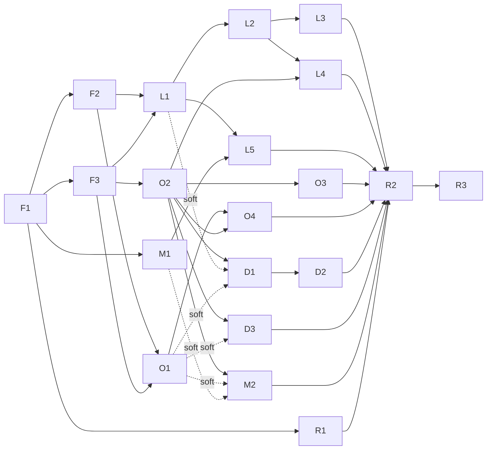

# Streams — SqueezeABCListen

_Stream decomposition. Drafted 2026-10-19 by the stream-planning sub-agent from `brief.md`, `OPEN-QUESTIONS.md`,
`research/abc-listen-api.md` (+ `abc-samples/`), `research/lms-plugin-guide.md`, `research/ecosystem.md`, `RUNBOOK.md`
and the SqueezeRTRFM planning output (format/granularity reference). Status values: planned → in progress → done._

| Stream | Outcome | Capabilities | Cross-stream deps | Size | Status |
|---|---|---|---|---|---|
| **foundation** | An installable "ABC listen" plugin skeleton that plays live radio on day 1, with stable `abclisten://` playback URLs and one robust ABC data client every feature builds on. | Installable skeleton (`install.xml`, OPMLBased `Plugin.pm` tag `abclisten` menu `radios`, strings, icon); frozen 5-hook menu API; `HTTP.pm`/`Util.pm` (URL + episode-metadata contracts, ISO-8601 with offsets); ported LMS-free test harness, `scripts/check.sh`, CI; `abclisten://` protocol handler with a per-kind resolver registry (live/episode), alternates + failure tokens; `API.pm`: BFF, `_next/data` with buildId discovery/refresh, Algolia (runtime key discovery, hourly budget), PAPI, music API, caching, coalescing, image/rich-text/card helpers. | Provides hooks, PH registry, API client, harness to every stream. | M (3 tasks) | planned |
| **live** | Every ABC listen live station (national, music, sport, local radio by state, time-zone versions) is listed with artwork and plays, showing the program on air, the current song on music stations, and a per-station schedule. | Static station catalogue + runtime `.pls` stream resolution (Icecast, never HLS); Live radio menus (networks, sport, local by state with home state first, time-zone versions); program on air (`epgNowPlaying`) in menus and Now Playing; live metadata push engine; song now-playing + recently played (music API); station submenu with Today/Yesterday/7-day schedule linking to catch-up programs; optional higher-quality live setting (mediahub / PlayHLS). | F1, F2, F3; L4 needs O2 (`programItem`); L5 needs M1 (settings page) | L (5 tasks) | planned |
| **ondemand** | Users browse ABC listen programs (by network, A–Z, type) and their episodes with artwork, synopsis, date and duration, and play any available episode (seekable, favouritable). | `abclisten://episode/<id>` resolver (episode Next data → renditions; MP3/AAC choice by availability windows; restricted/expired/geo messages); Programs → network → program → episodes menus; public `programItem`/`episodeItem` builders + program-menu extension registry; A–Z and by-type program index (Algolia); episode extras (segments, tracklist). | F2, F3; supplies builders to live (L4), discovery, myabc | L (4 tasks) | planned |
| **discovery** | Users explore ABC listen the way the website presents it: featured home collections, categories, popular now, podcasts collections, and search (also inside LMS global search). | Generic collection engine (home Next data → collections → cards → typed items); Featured/Discover menus; podcast categories, recommendations ("This Week's Most Listened"), podcasts page collections; Algolia search (programs + playable episodes) + `Slim::Menu::GlobalSearch` provider. | F3; O2 builders (hard); L1 `stationItem` + O1 playback (soft) | M (3 tasks) | planned |
| **myabc** | Users personalise the plugin without any ABC account: a settings page (home state), and locally followed programs with a "Latest episodes" feed. | `Settings.pm` + `basic.html` (owner sections), `homeState` pref; follow/unfollow from program menus and song info; "My ABC listen" menu (latest from followed, followed programs). ABC-account sync is stretch (OPEN-QUESTIONS #1). | F1; M2 needs O2 (program-menu registry) | S–M (2 tasks) | planned |
| **release** | Anyone can install ABCListen from one repository URL; releases are reproducible and automated; v1.0.0 ships with docs, screenshots and a scripted acceptance test. | Port of REF packaging: `build.sh`, `check-package.sh`, `update-repo-xml.pl`, `repo.xml` (placeholder sha), `release.yml`, `lms-repo-install.sh`, CHANGELOG/RELEASING; README (install, usage, screenshots, troubleshooting, limitations); `docs/official-repository.md`; `scripts/smoke.sh` JSON-RPC acceptance test; v0.1.0 → v0.2.0 → v1.0.0; clean-profile install from GitHub. | R1 needs F1; R2 needs every shipping task | M (3 tasks) | planned |

**Shape decisions (vs. the suggested shape).** (1) Packaging/release moved out of foundation into its own **release**
stream (it owns `scripts/` packaging, `.github/workflows/release.yml`, `repo.xml`, docs), so foundation stays the
small, frozen platform every feature depends on and R1 runs in parallel with the platform work. (2) Foundation's
first task is deliberately thin (plain Icecast URLs); the `abclisten://` handler (F2) and the ABC data client (F3)
follow in parallel, because they are the two contracts every other task codes against. (3) **Categories** live in
discovery (they are curated ABC collections rendered by the discovery collection engine); ondemand covers by-network,
A–Z and by-type. (4) The **settings page** lives in myabc (M1) but is section-owned, so live (L5) adds its own setting
without conflicts. (5) Search is its own hook/module (`Search.pm`) so D3 never conflicts with D1/D2.

Not streams: `dev/` (local LMS 9.1.1 + squeezelite "DevPlayer" test bed — dev-env agent) and `ai-state/` (orchestrator).

## Task index (all streams)

| ID | Title | Size | Depends on | Priority | Wave |
|---|---|---|---|---|---|
| F1 | Installable vertical slice: "ABC listen" in Radio with 5 playable national stations; hook API; HTTP/Util; harness; check.sh; CI | M (upper; review plan like L) | – | Must | 0 |
| F2 | `abclisten://` protocol handler framework (kind registry, alternates, failure tokens, metadata dispatch); slice stations move to stable URLs | M | F1 | Must | 1 |
| F3 | ABC data client `API.pm`: BFF, `_next/data` + buildId, Algolia (key discovery, budget), PAPI, music API, cache/coalesce, helpers; endpoint drift script | M | F1 | Must | 1 |
| R1 | Packaging + repo.xml + release workflow + README install; cut v0.1.0; local repo-install test | M | F1 | Must | 1 |
| M1 | Settings page (`Settings.pm`, `basic.html` owner sections) + `homeState` pref; `optionsURL` | S | F1 | Should | 1 |
| L1 | All live stations: catalogue, `.pls` resolution, Live radio menus (networks, sport, local by state, time-zone versions), live resolver | M (upper) | F2, F3 | Must | 2 |
| O1 | Episode playback engine: `abclisten://episode/<id>` resolver, rendition choice, availability/geo errors, metadata, seek, favourites | M (upper; highest technical risk) | F2, F3 | Must | 2 |
| O2 | Programs → network → program → episodes browse; public `programItem`/`episodeItem`; program-menu registry; episode meta cache | M (upper) | F3 | Must | 2 |
| L2 | Program on air: `NowPlaying.pm`, menu on-air lines, `LiveMetadata.pm` poll/push engine (program mode), song-info "On air" | M | L1 | Must | 3 |
| L5 | Higher-quality live setting (`standard` / `mediahub` / `hls` via PlayHLS) with automatic Icecast fallback | M | L1, M1 | Should | 3 |
| O3 | All programs A–Z and by type (Algolia program index, Algolia-down fallback) | M | O2 | Must | 3 |
| D1 | Collection engine + Discover → Featured/home collections (cards → program/episode/station/collection items) | M | F3, O2 (soft L1, O1) | Must | 3 |
| D3 | Search (Algolia programs + playable episodes) + LMS global search provider | M | F3, O2 (soft O1) | Must | 3 |
| M2 | Followed programs: follow/unfollow (program menu + song info), My ABC listen → Latest episodes / Followed programs | M | O2 (soft O1, M1) | Should | 3 |
| L3 | Now-playing songs on music stations (music API track mode, last-good, recently played) | M | L2 | Must | 4 |
| L4 | Station submenu: listen live + Today/Yesterday/7-day schedule linking to catch-up programs | M | L2, O2 | Should | 4 |
| O4 | Episode extras: segments (playable), tracklist, "More from <program>", episode song info | M | O1, O2 | Could | 4 |
| D2 | Categories, Popular now (recommendations), Podcasts collections | M | D1 | Must | 4 |
| R2 | `scripts/smoke.sh` acceptance test; README usage/screenshots/troubleshooting; official-repo guide; CHANGELOG | M | all shipping tasks | Must | 5 |
| R3 | v1.0.0 via workflow; clean-profile install from GitHub repo.xml; smoke pass; final verification; pi14 checklist | S | R2 | Must | 6 |
| _L6_ | _Stretch (out of v1): own HLS protocol handler (MPEG-TS → ADTS) for 221–246 kbps live, HLS-only stations, live rewind_ | L | L1, L5 | Stretch | – |
| _O5_ | _Stretch: episodes older than the newest 250 (Algolia), hide expired catch-up AAC before listing_ | M | O2, O3 | Stretch | – |
| _M3_ | _Stretch (out of v1, OPEN-QUESTIONS #1): ABC account (Gigya) sync of follows/history_ | L | M2 | Stretch | – |

20 v1 tasks (2 S, 18 M) + 3 stretch. Every task leaves the plugin installable and runnable after merge.

## Success criteria → tasks

| # | Brief criterion | Delivered by | Verified at |
|---|---|---|---|
| 1 | Every ABC listen live station listed with artwork and plays audio | F1 (5 stations play); F2 (stable `abclisten://live` URLs, favourites); L1 (all stations, artwork, Icecast resolution, Wide Bay via mediahub); L5 (mediahub/PlayHLS option; HLS-only stations playable with PlayHLS) | IC-1 (container sweep of every Icecast station); pi14 (mediahub, Wide Bay, HLS-only) |
| 2 | Browse programs and episodes (artwork + description + date + duration visible in the web UI) and play an episode | O2 (by network, episode rows/submenus); O3 (A–Z, by type); D2 (by category); O1 (playback, seek, favourites); O4 (segments/tracklist) | IC-2; IC-5 |
| 3 | Program on air for live stations, now-playing songs on music stations, episode/program descriptions | L2 (program on air: menus + Now Playing); L3 (songs + recently played); O2 (program/episode descriptions); L4 (schedule synopses); O4 (tracklists) | IC-4 |
| 4 | Discovery: featured collections/categories and search browsable | D1 (featured/home collections); D2 (categories, popular now, podcasts); D3 (search + global search) | IC-5 |
| 5 | Works without logging in; login-only features optional and secure | All tasks use keyless public endpoints only (no login code in v1, OPEN-QUESTIONS #1); M2 (local follows, no credentials); R3 (clean profile, no prefs/credentials, full smoke pass) | R3 |
| 6 | Install via the repository URL in LMS settings | R1 (pipeline, repo.xml, v0.1.0, local repo-install test); IC-3 (v0.2.0 from raw GitHub URL on clean profile); R3 (v1.0.0 from GitHub URL) | R1, IC-3, R3 |
| 7 | Automated tests + independent review + runtime verification on a real LMS | F1 (harness + CI); every task (unit tests, review agent, runtime check on the testbed); R2 (`scripts/smoke.sh`); R3 (final system verification; stakeholder runs smoke on pi14) | every PR; R3 |

Stakeholder-verified on pi14 (geo/IP-restricted, cannot pass in the US-egress container): mediahubaustralia live
streams (L1 Wide Bay, L5 `mediahub`), `/geo-001/` episode audio (O1), ABC Cricket and other geo/HLS sport streams
(L5 `hls`), AU-only EPG/schedule differences (L2, L4), final `scripts/smoke.sh` run (R3).

## Dependency graph

Integration checkpoints (run by the orchestrator's runtime-verification agent, not tasks):
- **IC-1** (after L1): every listed station resolves; scripted sweep plays each Icecast station ≥ 5 s on DevPlayer;
  HLS-only/off-air stations show their message; artwork in Default + Material → criterion 1 (container part).
- **IC-2** (after O1 + O2): Default + Material: Programs → network → program → episode → play, seek, favourite replay
  after restart; date/duration/description visible → criterion 2 (core).
- **IC-3** (after IC-2 + R1): cut **v0.2.0** via the release workflow; clean LMS profile installs it from the raw
  GitHub `repo.xml` → criterion 6 preview (stakeholder may try on pi14).
- **IC-4** (after L2 + L3): live context in Now Playing (program on talk stations, songs on music stations) in Default
  + Material + `status` JSON → criterion 3.
- **IC-5** (after O3 + D1 + D2 + D3 + M2): A–Z, categories, featured, popular, search (plugin + global), follow →
  criteria 2 and 4.

| Wave | Tasks (parallel) | Starts when |
|---|---|---|
| 0 | **F1** (vertical slice, alone) | now |
| 1 | **F2, F3, R1, M1** ← _first parallel batch_ | F1 merged |
| 2 | L1, O1, O2 | L1/O1: F2 + F3 merged; O2: F3 merged |
| 3 | L2, L5, O3, D1, D3, M2 | L1 / L1+M1 / O2 merged |
| 4 | L3, L4, O4, D2 | L2 / L2+O2 / O1+O2 / D1 merged |
| 5 | R2 | all shipping tasks merged (or descoped) |
| 6 | R3 | R2 merged |

Testbed prerequisites (dev-env agent, during wave 1; not stream tasks): **P1** install MaterialSkin into the testbed
(needed for the first Material screenshots in wave 2; `/material/` currently 404s); **P2** add `liburi-perl
libhtml-parser-perl shellcheck` (check.sh deps) to `dev/setup.sh` + RUNBOOK; **P3** (optional, for L5) PlayHLS +
ffmpeg in the testbed.

Critical paths (7 steps each): F1 → F3 → O2 → D1 → D2 → R2 → R3 and F1 → F2 → L1 → L2 → L3 → R2 → R3. Core criteria
1, 2 and 6 are met after wave 2 + IC-1/IC-2/IC-3.

Priority / descope order: **Must** F1, F2, F3, R1, L1, O1, O2, L2, L3, O3, D1, D2, D3, R2, R3 · **Should** M1, M2, L4,
L5 · **Could** O4 · **Stretch** L6, O5, M3. If time is short cut O4, then L5, then L4, then M2 (M1 only if L5 and M2
are both cut).

## Cross-stream contracts (fixed here; owners implement, consumers code against them)

1. **Hook API (F1, frozen).** `Plugin.pm` calls `Class->init()` (inside `eval`) and async
   `Class->menuItems($client, $cb, $args)` for `qw(Live OnDemand Discover Search MyABC)` in that order and concatenates
   the items. Each hook calls `$cb->(\@items)` exactly once; a hook that dies, misbehaves or misses `HOOK_TIMEOUT` (25 s)
   becomes one error text item. Final top level: **Live radio · Programs · Discover · Search ABC listen · My ABC listen**.
2. **URL contract (F1 `Util.pm`).** `abclisten://live/<SERVICE_ID>` (upper-case PAPI/BFF id, e.g. `TRIPLEJ`,
   `TRIPLEJ_PERTH`, `LOCAL_SYDNEY`) and `abclisten://episode/<coremediaId>` (numeric; covers `audioepisode`, `audio`,
   `audiosegment`). `Util::liveUrl`, `episodeUrl`, `parseUrl` → `{kind, id}` or undef. Favourites/presets only ever
   store these URLs, never CDN URLs.
3. **Episode metadata cache (F1 `Util.pm`).** `setEpisodeMeta($id, \%m)` / `getEpisodeMeta($id)`, cache namespace
   `abclisten`. Shape `{id, docType, title, programTitle, programId, path (canonical site path), image, description,
   date (epoch), duration (s)}` plus optional `{renditions => [{url, mime, bitrate}], availableTo, downloadAvailableTo,
   seenAt}`. Written by O2, O3, D1, D2, D3, M2; read by O1 (resolver), O4, M2.
4. **Protocol-handler kind registry (F2, `ProtocolHandler.pm` frozen after F2).**
   `Plugins::ABCListen::ProtocolHandler->registerKind($kind, {resolve, metadata, onStream?, onStop?})`:
   `resolve($client, $id, $cb)` → `$cb->({url, alternates => [...], meta => {...}, failToken => 'PLUGIN_…'})` or
   `$cb->({error => 'PLUGIN_…'})`; the PH tries `url` then each alternate, and reports `failToken` (default
   `PLUGIN_ABCLISTEN_STREAM_FAILED`) if all fail. Candidates are URL strings or `{url, hls => 1}`; the PH never hands
   LMS an `.m3u8` unless flagged `hls` (only L5 does, when PlayHLS is enabled). `metadata($client, $url, $id)` is synchronous, no network, never
   dies → `{title, artist, album, cover, duration}`. Kinds: `live` (registered by `Live->init`), `episode`
   (`Episode->init`, which F1's `OnDemand->init` already calls).
5. **ABC data client (F3 `API.pm`).** `bff`, `nextData` (buildId discovery, one refresh-and-retry on 404, follows
   `__N_REDIRECT`), `algolia` (runtime appId/key/index discovery from `/listen/search`, hourly budget → error
   `PLUGIN_ABCLISTEN_RATE_LIMITED`), `papi`, `music`, `text`; all `($…, $cb, $ecb, \%opts)` with exactly one callback;
   opts `ttl`, `stale_ok`, `quiet`. Pure helpers `imageUrl`, `richText`, `coreMediaRef`, `cardRef`, `sitePath`.
6. **On-demand builders (O2, `OnDemand.pm`).** `programItem($client, \%program)` (program = `{title, path, id?, image?,
   description?, network?}`; `path` required) → OPML `link`; `episodeItem($client, \%episode)` (meta-cache shape; `id`
   required) → `link` with `play => abclisten://episode/<id>` and writes the meta cache;
   `registerProgramMenuProvider(sub { my ($client, $program, $cb) = @_; $cb->(\@items) })` → extra items at the top of
   every program menu (used by M2).
7. **Live builders (L1, `Live.pm`/`Stations.pm`).** `Live->stationItem($client, $serviceId)` → playable station item
   (or undef); `Stations->byPageSlug($slug)` → service id (for `coremedia://channel` cards whose `articleLink` is
   `/listen/live/<slug>`).
8. **Prefs (`plugin.abclisten`).** `homeState` ('' | ACT | NSW | NT | QLD | SA | TAS | VIC | WA; '' behaves as NSW;
   owner M1, read by L1/L4), `liveQuality` (`standard` | `mediahub` | `hls`; owner L5, default `standard`), `followed`
   (array; owner M2). Each owner calls `$prefs->init` for its own keys in its hook `init`; readers treat undef as the
   default. No credentials or tokens are ever stored.

## Parallel-work rules (file-conflict mitigation)

1. **`Plugin.pm` is frozen after F1** (hook list, `abclisten` PH registration, log category). **`ProtocolHandler.pm` is
   frozen after F2.** Changes need orchestrator sign-off.
2. **`strings.txt`**: F1 creates `# === <ID> ===` sections for every task and pre-seeds all tokens named in the master
   plans; a task edits only inside its own section (new tokens appended there, flagged in the PR).
3. **`install.xml`**: `<version>` changes only in release commits (the release workflow triggers on it); `optionsURL` is
   added once by M1.
4. **`Settings.pm` / `basic.html`** (M1): owner sections (`<!-- === L5 === -->` in v1; future owners add their own);
   the `prefs` list is append-only.
5. **Builder ownership.** `OnDemand.pm`: O2 creates everything; afterwards O3 owns `_programsRoot`, O4 owns
   `episodeItem`/`_episodeMenu`; `programItem`/`_programMenu` stay with O2 (M2 uses the registry, never edits).
   `Live.pm`: L1 creates; L2 owns `_stationItem` text (line2/description); L4 (after L2) owns `_stationItem` type and
   `_stationMenu`. `LiveMetadata.pm`: L2 creates, L3 extends (track mode). `Stations.pm`: L1 creates, L5 extends stream
   candidates. `Discover.pm`: D1 creates, D2 extends the root list.
6. **Tests**: prefixes `t/1x` foundation, `t/2x` live, `t/3x` ondemand, `t/4x` discovery, `t/5x` myabc, `t/9x`
   release; fixtures in `t/data/<stream>/` copied from `research/abc-samples/` (trimmed, shape unedited) plus
   synthetic edge cases; `t/lib` stubs change additively only; `prove`/CI never touch the network.
7. **`README.md`, `repo.xml`, `RELEASING.md`, `CHANGELOG.md`, `docs/`, packaging scripts, `release.yml`** belong to
   release. Feature tasks describe user-visible changes in their PR body; R2 folds them into the docs.
   `scripts/check.sh` and `ci.yml` belong to foundation (R1 may append package checks).

| Path | Created by | Owner afterwards | Rule |
|---|---|---|---|
| `ABCListen/Plugin.pm` | F1 | foundation | frozen |
| `ABCListen/install.xml` | F1 | foundation | version only in release commits; M1 adds `optionsURL` |
| `ABCListen/strings.txt` | F1 | shared | own section only |
| `ABCListen/HTTP.pm`, `Util.pm`, `API.pm` | F1, F1, F3 | foundation | append-only if unavoidable; flag in PR |
| `ABCListen/ProtocolHandler.pm` | F1 (stub) → F2 | foundation | frozen after F2 |
| `ABCListen/HTML/EN/plugins/ABCListen/html/**` | F1 | foundation | – |
| `ABCListen/Live.pm`, `Stations.pm` | F1 (stub), L1 | live | rule 5 |
| `ABCListen/NowPlaying.pm`, `LiveMetadata.pm`, `Tracks.pm`, `Schedule.pm` | L2, L2, L3, L4 | live | rule 5 |
| `ABCListen/OnDemand.pm`, `Programs.pm`, `Episode.pm`, `ProgramIndex.pm` | F1 (stub), O2, F1 (stub; `OnDemand->init` calls `Episode->init`) → O1, O3 | ondemand | rule 5; O1 never edits `OnDemand.pm` |
| `ABCListen/Discover.pm`, `Collections.pm`, `Search.pm` | F1 (stubs), D1, D3 | discovery | rule 5 |
| `ABCListen/MyABC.pm`, `Settings.pm`, `Follow.pm`, `HTML/EN/plugins/ABCListen/settings/basic.html` | F1 (stub), M1, M2, M1 | myabc | rule 4 |
| `t/lib/**`, `scripts/check.sh`, `scripts/lint-strings.pl`, `.github/workflows/ci.yml` | F1 | foundation | stubs additive; R1 may append to check.sh/ci.yml |
| `repo.xml`, `scripts/{build,check-package,update-repo-xml,changelog-section,lms-repo-install,smoke}.*`, `.github/workflows/release.yml`, `README.md`, `RELEASING.md`, `CHANGELOG.md`, `docs/` | R1/R2 | release | features don't edit |
| `scripts/abc-endpoints-check.sh` | F3 | foundation | – |
| `dev/`, `ai-state/` | dev-env agent / orchestrator | orchestrator | changes via orchestrator |

## Shared resources & conventions

- **Runtime test bed**: one LMS 9.1.1 at http://localhost:9000 + DevPlayer (`00:00:00:00:00:01`) — see `RUNBOOK.md`.
  Hold the lock (`dev/testbed-lock.sh acquire <ID>`), link your worktree (`PLUGIN_SRC=<worktree>/ABCListen
  dev/link-plugin.sh --restart`), verify, re-link the main checkout, release. Live playback in the container uses the
  StreamGuys Icecast streams; mediahubaustralia and `/geo-001/` are stakeholder-verified on pi14.
- **Every user-facing task verifies three renderings**: Default skin screenshot (`dev/browser/screenshot.mjs`), Material
  screenshot (after P1), and JSON-RPC `["abclisten","items",0,N,"item_id:…","menu:1"]` (Jive/hardware-player shape).
  Playback checks use `status` (`mode`, `time` advancing, `current_title`, `artwork_url`) and a clean `server.log`.
- **Reference implementation**: <https://github.com/wilsonwaters/SqueezeRTRFM> v1.0.0 (clone read-only into the
  scratchpad); paths in plans like "REF `RTRFM/Live.pm:131-146`" refer to it.
- **ABC etiquette**: all HTTP through `HTTP.pm`/`API.pm` (explicit LMS User-Agent, async only); cache aggressively;
  coalesce identical requests; Algolia ≤ 400 queries/h/IP (plugin budget 300/h); poll now-playing only for stations a
  player is actually playing; never re-host audio.
- **GitHub releases** are cut only by the release workflow; the orchestrator triggers it (version-bump commit or
  `workflow_dispatch` via GitHub MCP). Cadence: v0.1.0 (R1) → v0.2.0 (IC-3) → optional v0.3.0 after wave 4 → v1.0.0 (R3).
- **Branches/PRs**: `feat/<ID>-<slug>`, one PR per task, `scripts/check.sh` green before review.

## Ambiguities in the brief (defaults applied; confirm with stakeholder)

1. **"Every live station plays"** — six services have no Icecast stream (ABC Cricket [also geo-blocked], ABC Sport
   Rapid, ABC RLWC Rapid, Kids listen NT/QLD/SA/WA, **ABC Wide Bay**) and several sport services are event-only.
   Default: list a station only when it has a native path (Wide Bay via mediahub AAC, pi14-verified; Kids variants
   hidden — the main Kids listen stream plays; Sport Rapid/RLWC Rapid/Cricket listed only with L5 `hls` + PlayHLS;
   event-only services listed while ABC reports a stream). Full native HLS is stretch L6.
2. **Which stations count** — PAPI has 108 services incl. hidden ones (`RN_vic`, `RN_tas`, `firstrun`, `dig`). Default:
   the ABC listen site's live lists (national networks + 8 state collections) plus the time-zone versions it offers.
3. **"Category"** (criteria 2 and 4) — taken to mean ABC listen's 8 podcast categories (D2); program type
   (podcast / catch-up / music / audiobook / news) is offered as an extra by O3.
4. **Episode depth** — ABC's episode API returns only the newest 250 per program; deeper history is stretch O5.
5. **Material skin** — required by the brief but not installed in the testbed (prerequisite P1).
6. **Followed programs** are server-wide (shared by all players on the LMS), not per player — default; per-player
   is a cheap switch in M2 if wanted.
7. **Algolia search key** — ABC's public, page-embedded search-only key. Default: discovered at runtime from
   `/listen/search`, not committed in code (FQ3); it is already present in `research/` docs.
8. **Release commit identity** (OPEN-QUESTIONS #2) decides who `release.yml` commits `repo.xml` as (R1).
9. **Plugin icon** — ABC logos are trademarks; default a neutral self-made icon (FQ1).

## Changelog
- 2026-10-19 — Initial decomposition (stream-planning sub-agent): 6 streams, 20 v1 tasks + 3 stretch.
